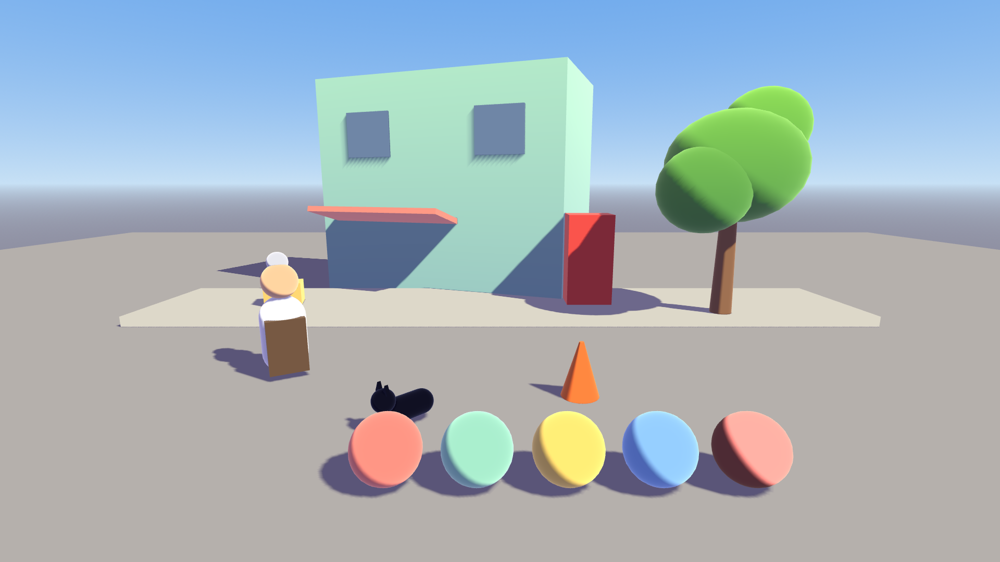

# Estilo cozy (`estilo_cozy.gdshader`)

Shader `spatial` para personajes, edificios, árboles y props, con look de caricatura limpia:
luz de cel suave, sombras teñidas de azul violáceo que conservan el color del objeto, un rim sutil
y un degradado vertical opcional. Hecho para **GL Compatibility** (web y teléfono): no usa SDFGI,
SSAO ni volumetría, y lee como mucho una textura (opcional).



## Uso rápido

1. En un `MeshInstance3D`, *Surface Material Override* → **New ShaderMaterial** → *Shader*:
   `res://shaders/estilo_cozy.gdshader`.
2. Elegí `color_base`. Con eso alcanza para la mayoría de los props.
3. Ajustá lo demás desde el inspector (los uniforms están agrupados).

Desde código:

```gdscript
var mat := ShaderMaterial.new()
mat.shader = preload("res://shaders/estilo_cozy.gdshader")
mat.set_shader_parameter("color_base", Color(0.96, 0.56, 0.5))
mesh_instance.material_override = mat
```

Escena de prueba: `tests/prueba_estilo.tscn`. Tiene personaje, gato, edificio, árbol, cono,
máquina expendedora, cajón y una fila de esferas de muestra. La última esfera tiene
`intensidad_tinte = 0` para comparar con una sombra sin tinte. Para sacar una captura:
`godot --path . res://tests/prueba_estilo.tscn -- <carpeta>` (no headless).

## Uniforms

| Grupo | Uniform | Default | Para qué |
|---|---|---|---|
| estilo | `color_base` | blanco | Color del objeto. Se multiplica por `textura_albedo`. |
| | `textura_albedo` | blanco | Opcional. Sin asignar no cambia nada. Filtro lineal con mipmaps y anisotrópico (lajas, baldosas). |
| | `usar_paleta` / `textura_paleta` | false / blanco | Atlas de colores (la paleta del Kit): filtro lineal simple, sin mipmaps, para que las celdas no se mezclen. Se lee esta en vez de `textura_albedo`. |
| | `usar_textura_emision` / `textura_emision` / `emision_energia` | false / negro / 1.0 | Emisión por textura (faroles, faros, semáforos). Apagada no se lee. |
| | `usar_color_vertices` | false | Multiplica por el color de los vértices (mallas fusionadas, personas, autos). |
| | `usar_uv_mundo` / `escala_uv_mundo` | false / (1, 1) | Proyecta la textura con la posición en el mundo, en el plano al que más mira la cara: las losas vecinas siguen el dibujo sin uniones. Una sola lectura. |
| | `roughness` | 0.9 | Alto: nada de brillos. |
| | `specular` | 0.1 | Bajo. Sólo afecta reflejos del entorno; las luces no suman especular. |
| iluminacion | `umbral_sombra` | 0.0 | NdotL donde cae la sombra. Negativo = más superficie iluminada. |
| | `ancho_transicion` | 0.15 | Suavidad del borde luz/sombra. 0.02 queda cel duro; 0.4 casi Lambert. |
| sombra | `shadow_tint` | (0.45, 0.42, 0.62) | Color al que va la sombra, multiplicado por el albedo. |
| | `intensidad_tinte` | 1.0 | 0 = sin tinte (la sombra queda sólo con la luz ambiente). |
| rim | `rim_color` | crema | Color del borde. Para objetos oscuros, mejor un azul claro. |
| | `rim_intensidad` | 0.25 | Sutil. Ponelo en 0 en el suelo y en paredes grandes. |
| | `rim_power` | 3.0 | Más alto = borde más fino. |
| degradado | `usar_degradado` | false | Activa el degradado vertical. |
| | `degradado_arriba` / `degradado_abajo` | crema / lavanda | Colores de los extremos. |
| | `degradado_altura_min` / `_max` | 0 / 2 | Rango de altura del degradado. |
| | `usar_altura_mundial` | false | true: altura en el mundo (copas de árbol que se oscurecen hacia abajo aunque estén rotadas o escaladas). false: altura local del mesh. Ojo: en un `BoxMesh` el origen está en el centro (de -alto/2 a +alto/2). |
| | `degradado_fuerza` | 0.6 | Cuánto se aplica. Es multiplicativo: matiza el color sin reemplazarlo. |
| avanzado | `compat_sol_con_sombras` | true | Sólo Compatibility. Dejalo en true si el sol tiene `shadow_enabled` (como en la plaza); si no, en false. |

## En el juego

- `Construir.material(color)`: opaco y con sombra devuelve un `ShaderMaterial` cozy (cacheado por
  color, con la meta `color_plano` para fusionar). Transparente o sin sombra sigue siendo
  `StandardMaterial3D`. `Construir.material_cozy()` arma uno nuevo con los ajustes del mundo
  (rim 0.15 y degradado leve por altura en el mundo, de 0 a 10 m, fuerza 0.3).
- `Construir.material_vertices()`, `material_lajas()` y `material_baldosas()` usan el mismo shader.
- `Kit.material()`: la paleta del kit va en `textura_paleta` y los faroles en `textura_emision`.
- La paloma (`paloma_zonas.gdshader`) incluye la misma luz (`estilo_cozy_luz.gdshaderinc`), y sus
  párpados usan `material_cozy()`.
- `world/plaza.gd`: sol a energía 1 sin `shadow_opacity`, ambiente a 0.3 y tonemap lineal.

- Global `cozy_cielo` (en `project.godot`, `[shader_globals]`): multiplica el piso teñido y el rim
  de todos los shaders cozy. La pone `world/cielo.gd`: blanco de día, azul oscuro de noche, gris con
  lluvia. En la escena de prueba vale blanco.

Para sumar la luz cozy a otro shader: `#include "res://shaders/estilo_cozy_luz.gdshaderinc"`, al
final de `fragment()` (con `ALBEDO` ya escrito) `COZY_FRAGMENT;`, y no definir otra `light()`.

## Cómo funciona

Con una luz blanca de energía 1, el resultado es `mix(ALBEDO * shadow_tint, ALBEDO, luz)`, más la
luz ambiente y el rim:

- **Piso teñido** (`fragment()`, en `EMISSION`): `ALBEDO * shadow_tint * intensidad_tinte`. No depende
  de las luces, así que lo que no recibe luz directa (el lado oscuro o una sombra proyectada) queda
  violáceo y conserva su color, nunca negro.
- **Luz** (`light()`, una vez por luz): `smoothstep(umbral - ancho, umbral + ancho, NdotL) *
  ATTENUATION * LIGHT_COLOR`. Suma sólo lo que falta para llegar al color pleno (`1 - tinte`), y no
  suma piso, así que con dos luces el tinte no se duplica. Como `ATTENUATION` incluye el mapa de
  sombras, las sombras proyectadas tienen el mismo tinte que el lado oscuro.
- **Rim**: `pow(1 - dot(NORMAL, VIEW), rim_power) * rim_intensidad` en `EMISSION`.

### Detalle de GL Compatibility (medido en 4.7.2)

En Compatibility, `ALBEDO`, `EMISSION` y los `source_color` se manejan en sRGB (el motor los pasa
a lineal al final), pero `DIFFUSE_LIGHT` es lineal. Además, una luz direccional **con sombras** se
dibuja en un pase aparte que se suma en sRGB al pase base. Sin corregir esto, un gris 0.5
iluminado salía 0.68. `light()` lo compensa según `compat_sol_con_sombras`, y en Forward+/Mobile
usa la fórmula directa (`#if CURRENT_RENDERER`). Medido con esferas de frente al sol: iluminado =
`color_base` (±0.03) y sin luz = `color_base * shadow_tint`, con y sin sombras. Forward+/Mobile no
se midió.

La luz ambiente del `WorldEnvironment` se suma aparte (como en cualquier material). Para no lavar
los colores conviene una energía baja (0.2 a 0.5) con un color frío, y
`reflected_light_source = Disabled`.

## Valores sugeridos

| Tipo | Ajustes |
|---|---|
| Personaje | `rim_intensidad` 0.25 a 0.35. Para pelaje negro: `rim_color` azul claro (0.62, 0.68, 1). |
| Edificio | `usar_degradado` con altura local, `degradado_fuerza` 0.4 a 0.5. |
| Árbol (copa) | `usar_altura_mundial`, rango de la copa, `ancho_transicion` 0.25, `umbral_sombra` -0.1. |
| Suelo, vereda | `rim_intensidad` 0. |
